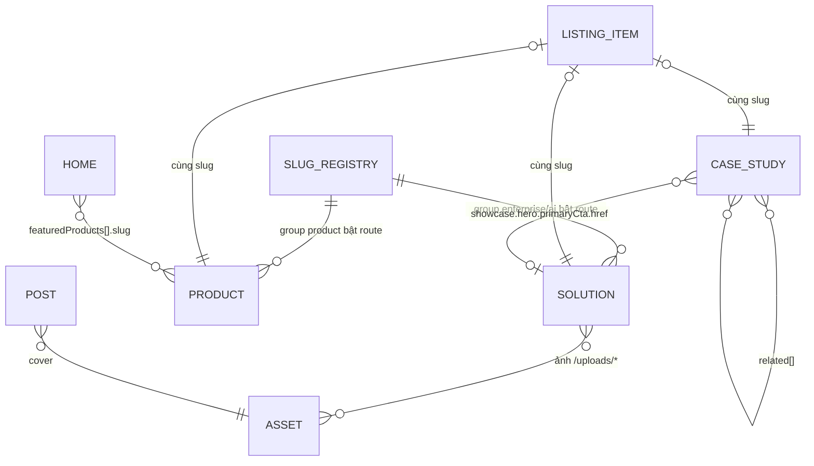

# 08 — Mô hình dữ liệu (PostgreSQL — as-built từ 14/10/2026)

Prod đọc nội dung từ **PostgreSQL** (`CONTENT_SOURCE=db`, CR-031). File `src/content/**`, `src/i18n/messages/*.json`,
`src/lib/content/slug.ts`, `src/lib/contact/company-info.ts` giờ **chỉ là seed** — sửa file KHÔNG đổi web.
Bot thao tác dữ liệu = gọi `db:cli` (create / update / delete / rollback / upload / revalidate) — xem `05`.
Nguồn sự thật: `docs/ERD.md` · `src/db/schema.ts` · `src/db/content-rules.ts` · `src/db/content-repo.ts`.

## 1. Bảng

| Bảng | Vai trò | Cột chính |
|---|---|---|
| `content_entries` | 1 hàng = 1 bản ghi nội dung hiện tại | `id`, `collection`, `slug`, `locale` (`vi`/`en`), `data` (jsonb), `body` (MDX, chỉ post/about…), `sort_order`, `version`, `deleted_at`, `updated_by` |
| `content_versions` | Lịch sử append-only, mỗi lần ghi 1 hàng | `entry_id`, `version`, `op` (`create`/`update`/`delete`/`rollback`), `data`, `body`, `sort_order`, `actor`, `note` |

- **Khoá:** (`collection`, `slug`, `locale`) — duy nhất kể cả bản ghi đã xoá mềm. Khoá **không đổi tại chỗ**.
- **`data`** = nguyên frontmatter MDX / object TS trước đây (document store, không tách bảng con).
  → Field, enum, cấu trúc trong `02` và `06` vẫn đúng: chỉ khác là nằm trong `data` (JSON) thay vì YAML.
- **`body`** = phần thân MDX dưới frontmatter (blog). Bản ghi khác để `null`.
- **`version`** tăng 1 mỗi lần ghi. Ghi phải kèm `expectedVersion` = version đang thấy → lệch (người khác vừa sửa) = conflict, không ghi.
- **Xoá mềm:** `deleted_at` ≠ null → web không thấy; lịch sử còn, khôi phục bằng `rollback`.
- **`actor`:** bot ghi `bot:<telegram-user-id>` (người bấm Duyệt).

## 2. Collection ↔ dữ liệu cũ

| Collection | `slug` | `data` chứa | Seed cũ (chỉ tham khảo) |
|---|---|---|---|
| `post` | slug bài | frontmatter blog (`02` §1) + `body` | `src/content/blog/{vi,en}/*.mdx` |
| `solution` | slug giải pháp | frontmatter giải pháp (`02` §2) | `src/content/solutions/{vi,en}/*.mdx` |
| `product` | slug sản phẩm | frontmatter sản phẩm (`02` §3) | `src/content/products/{vi,en}/*.mdx` |
| `case_study` | slug case study | frontmatter case study (`02` §4) | `src/content/case-studies/{vi,en}/*.mdx` |
| `about` | `about` | `mission`, `milestones`, `partners` (`02` §5) | `src/content/about/{vi,en}/about.mdx` |
| `slug_registry` | slug solution/product | `{ "group": "enterprise" \| "ai" \| "product" }`; `sort_order` = thứ tự hiển thị | `src/lib/content/slug.ts` |
| `listing_item` | slug item | 1 entry `listingItems[slug]` (icon, theme, categories, subtitle, chips) | `src/content/listings.ts` |
| `listing_page` | `products` / `caseStudies` / `enterprise` / `ai` | hero + danh mục lọc 1 trang danh sách | `listings.ts` → `listingPages` |
| `listing_cta` | như `listing_page` | CTA cuối trang danh sách | `listings.ts` → `listingCtas` |
| `listing_labels` | `labels` | nhãn chung trang danh sách | `listings.ts` → `listingLabels` |
| `home` | `home` | `solutionCards`, `featuredProducts`, `heroPanels` | `src/content/home.ts` |
| `solution_overview` | `enterprise` / `ai` | tiêu đề/mô tả nhóm giải pháp | `src/content/solutions/overview.ts` |
| `ui_messages` | namespace cấp 1 (`nav`, `home`, `footer`, `blog`, `about`, `contact`…) | toàn bộ object namespace đó | `src/i18n/messages/{vi,en}.json` |
| `company_info` | `contact` | SĐT, email, địa chỉ, bản đồ (giống nhau vi/en) | `src/lib/contact/company-info.ts` |
| `asset` | sha256 ảnh, `locale` luôn `vi` | `{path, sha256, mime, bytes, width, height, alt:{vi,en}}` | tạo bằng `db:cli upload` |

`slug_registry` và `company_info` không theo ngôn ngữ nhưng `locale` bắt buộc → **ghi giống nhau cho cả vi và en**.

## 3. Quan hệ (không có FK thật — liên kết bằng chuỗi slug / đường dẫn)

Write-path chặn ảnh thiếu (I-7) và registry sai (I-3/I-4), nhưng **không** bắt `href`/`related`/`featuredProducts` trỏ slug đã xoá
→ bot tự kiểm khi xoá / đổi slug (`03`).

## 4. Ràng buộc (write-path tự kiểm — sai thì CLI từ chối, exit 1)

| # | Ràng buộc | Thực thi |
|---|---|---|
| — | Required fields theo collection (`REQUIRED_FIELDS`): post `slug,title,date,category,excerpt,cover,body` · solution `slug,title,description,features,benefits,category,showcase` · product `slug,title,description,screenshots,showcase` · case_study `slug,title,category,year,challenge,solution,result,gallery,related` · about `mission,milestones,partners` | chặn |
| I-1 | Mỗi slug có đủ cặp vi + en | **cảnh báo** (tạo vi rồi en ngay sau) |
| I-2 | slug `a-z0-9-`; `data.slug` = khoá (post/solution/product/case_study) | chặn |
| I-3/I-4 | solution/product phải có `slug_registry` đúng nhóm (`category` = `group`) | chặn → tạo registry **trước** nội dung |
| I-5 | Khoá duy nhất kể cả bản đã xoá mềm | chặn → slug từng dùng thì không tạo lại được, dùng `rollback` để khôi phục |
| I-6 | Enum: category blog/solution/case study, nhóm registry, icon showcase; `company_info`: `phone.href` `tel:`, `email.href` `mailto:`, `map.embedUrl` https Google Maps | chặn |
| I-7 | Ảnh tham chiếu tồn tại: `/uploads/*` = asset còn sống; `/images/*` = file có trong `public/` | chặn |
| I-8 | Xoá bản ghi có URL công khai (post/solution/product/case_study) cần cờ `--confirm-public-url-change` | chặn nếu thiếu cờ; kèm cảnh báo cần redirect 301 |

Thêm: `ui_messages` / `company_info` **không được** có chuỗi rỗng / mảng rỗng (web gộp DB đè lên file; sai kiểu hoặc rỗng → lỗi trang).
Key thiếu trong DB thì web lấy từ file + log `[content-shape]`.

## 5. Ngoài DB (bot KHÔNG sửa được — việc của dev, cần deploy code)

| Dữ liệu | Nơi |
|---|---|
| `<title>` + meta description trang chủ / giới thiệu | `homeMetadata` / `aboutMetadata` trong `src/app/[locale]/page.tsx`, `about/page.tsx` |
| Redirect 301 (khi xoá / đổi slug công khai) | `next.config.ts` → `redirects()` |
| Thêm enum mới (category, icon, theme), loại trang mới, giao diện | code `src/**` |
| Form liên hệ (bài nộp) | không lưu — forward qua `CONTACT_FORM_TARGET` |

Xem bảng chi tiết từng khối trên giao diện → `09-web-to-data-map.md`.
